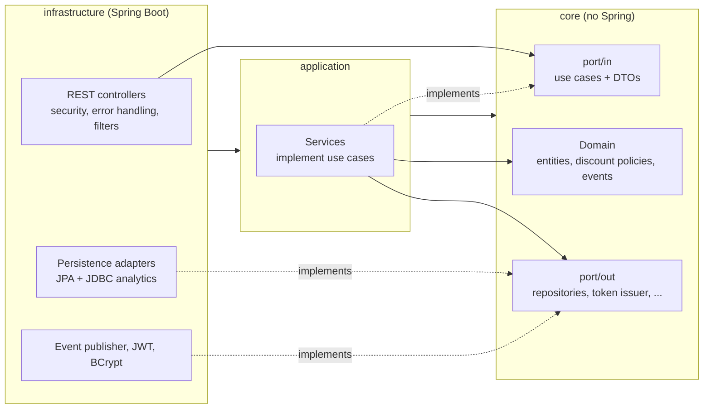

# Stock Pilot

Inventory and point of sale (POS) REST API for small businesses: product catalog, stock ledger, sales with discounts and cancellation, analytics reports, JWT authentication and role based access.

**Stack:** Java 21, Spring Boot 3.3, Spring Data JPA / Hibernate, Spring Security (JWT resource server), PostgreSQL, Flyway, springdoc-openapi, Testcontainers, JUnit 5, Mockito, Maven, Docker, GitHub Actions.

## Features
- **Catalog:** categories, products with description, category and active flag (soft delete), SKU normalised to upper case, search by name / category / active / low stock with pagination and sorting.
- **Stock ledger:** every registration, restock, sale, cancellation and manual adjustment records a movement (IN / OUT / ADJUSTMENT, signed quantity, reason, reference, resulting balance) in the same transaction. Adjustments require a reason and can never take stock below zero.
- **Sales:** checkout with percentage or fixed-amount discount (never both, never above the subtotal), cash payments with `amountReceived` and `change`, receipt numbers (`SALE-000123`) from a PostgreSQL sequence, cancellation that restores stock (only once), lookup and filtered/paginated listing.
- **Analytics (native PostgreSQL SQL):** top selling products, revenue by payment method, revenue by day / week / month (`date_trunc` + cumulative window sum), stock valuation per category, low stock list. Cancelled sales are always excluded.
- **API quality:** OpenAPI + Swagger UI, RFC 7807 `application/problem+json` errors (with a field `errors` list for validation failures), `X-Request-Id` correlation id propagated to logs (MDC) and error bodies.
- **Security:** stateless JWT (HS256), BCrypt passwords, `ADMIN` / `CASHIER` roles.
- **Operations:** Actuator health/info, multi-stage Docker image running as a non-root user, full-stack `docker-compose`, `hmg` / `prod` Spring profiles, CI on GitHub Actions.

## Architecture (multi-module Maven, ports & adapters)

```
stock-pilot/
├── core/            domain, business rules, pagination model, ports (in = use cases + DTOs, out = repositories & services)
├── application/     use case implementations (services), mappers
└── infrastructure/  Spring Boot app: controllers, security, error handling, JPA/JDBC adapters, Flyway migrations
```
Dependencies point inward: `infrastructure -> application -> core`. Each layer is its own Maven module, so the compiler enforces it. `core` only depends on `jakarta.persistence` and `jakarta.validation`. Controllers depend on use-case interfaces only. Pagination (`PageQuery` / `PageResult`) is framework independent and translated to Spring Data in the adapters.

## Run
Requires Java 21 and Docker.

**Full stack with Docker (PostgreSQL + app):**
```
docker compose up -d --build
curl localhost:8080/actuator/health
```
The compose stack uses the `local` profile, which provides development-only defaults: admin `admin@stockpilot.local` / `admin12345` and a development JWT secret. Open Swagger UI at http://localhost:8080/swagger-ui.html.

**From source:**
```
docker compose up -d postgres             # PostgreSQL on localhost:5432
./mvnw test                               # integration tests use Testcontainers (real PostgreSQL)
SPRING_PROFILES_ACTIVE=local ./mvnw spring-boot:run -pl infrastructure
```

**Authenticate:**
```
TOKEN=$(curl -s -X POST localhost:8080/api/auth/login -H 'Content-Type: application/json' \
  -d '{"email":"admin@stockpilot.local","password":"admin12345"}' | jq -r .accessToken)
curl -H "Authorization: Bearer $TOKEN" localhost:8080/api/products
```

### Configuration
| Variable | Purpose | Default |
|----------|---------|---------|
| `DB_URL`, `DB_USER`, `DB_PASSWORD` | PostgreSQL connection | local PostgreSQL (required in `hmg` / `prod`) |
| `JWT_SECRET` | HMAC secret, at least 32 characters. The app refuses to start without it | dev value only in the `local` profile |
| `JWT_EXPIRATION` | token lifetime | `1h` |
| `APP_ADMIN_EMAIL`, `APP_ADMIN_PASSWORD` | administrator created on startup when no user exists | dev values only in the `local` profile |
| `SPRING_PROFILES_ACTIVE` | `local`, `hmg` or `prod` | none |

Schema is versioned with Flyway (`infrastructure/src/main/resources/db/migration`) and validated by Hibernate (`ddl-auto=validate`).

## Endpoints
Interactive documentation: `/swagger-ui.html` (spec at `/v3/api-docs`).

| Area | Endpoint | Role |
|------|----------|------|
| Auth | `POST /api/auth/login` | public |
| Auth | `POST /api/auth/register` | ADMIN |
| Products | `GET /api/products` (filters `name`, `categoryId`, `active`, `lowStockOnly`; `page`, `size`, `sortBy`, `direction`) | ADMIN, CASHIER |
| Products | `GET /api/products/{id}`, `GET /api/products/low-stock` | ADMIN, CASHIER |
| Products | `POST /api/products`, `PUT /api/products/{id}`, `POST /api/products/{id}/deactivate`, `/reactivate`, `/restock` | ADMIN |
| Stock | `POST /api/products/{id}/adjustments`, `GET /api/products/{id}/movements` | ADMIN |
| Categories | `POST /api/categories`, `GET /api/categories`, `GET /api/categories/{id}` | ADMIN |
| Sales | `POST /api/sales` | ADMIN, CASHIER |
| Sales | `GET /api/sales` (filters `from`, `to`, `paymentMethod`, `status`; pagination), `GET /api/sales/{id}`, `POST /api/sales/{id}/cancel` | ADMIN |
| Reports | `GET /api/reports/daily?date=`, `/top-products?from=&to=&limit=`, `/revenue-by-payment-method?from=&to=`, `/revenue?from=&to=&granularity=DAY\|WEEK\|MONTH`, `/stock-valuation`, `/low-stock` | ADMIN |
| Operations | `GET /actuator/health`, `GET /actuator/info` | public |

Errors follow RFC 7807, for example:
```json
{
  "type": "urn:stockpilot:problem:business-rule-violation",
  "title": "Unprocessable Entity",
  "status": 422,
  "detail": "Sale SALE-000007 is already cancelled",
  "instance": "/api/sales/7/cancel",
  "timestamp": "2026-11-05T13:00:00Z",
  "requestId": "6d2a1c0e-..."
}
```

## Branching model
| Branch | Purpose |
|--------|---------|
| `main` | production; receives release PRs from `hmg` and is tagged `vX.Y.Z` |
| `hmg` | homologation (integration) branch; receives feature PRs |
| `feat/*`, `fix/*` | short-lived branches created from `hmg` |

Commits are in English, imperative, prefixed with `feat:` or `fix:`. Every PR must pass CI (`./mvnw -B verify`). See [CONTRIBUTING.md](CONTRIBUTING.md) for the full flow.

## Testing
`./mvnw verify` runs domain and service unit tests (JUnit 5, Mockito, AssertJ), `@WebMvcTest` controller tests, an authorization matrix and Testcontainers integration tests against a real PostgreSQL 16 (persistence, native analytics SQL, end-to-end flows with real JWTs).

## Roadmap
Returns/refunds, suppliers and purchase orders, refresh tokens, user management (deactivate / change password).
